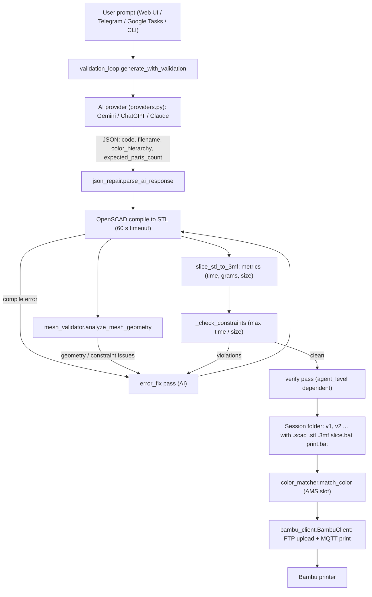

# 01 – System Architecture

Text-to-Printer turns a plain-English prompt into a physical print:
**prompt → AI (OpenSCAD) → compile to STL → mesh check → slice into a 3MF → Bambu printer**.
This page describes how the pieces fit together. Everything here is derived from the current source code.

## End-to-end pipeline



Step by step:

1. **Prompt + context** – [`prompts.py`](../../src/core/ai/prompts.py) builds the content prompt (previous code, size/time/grams and constraint hints for edits).
2. **Generate** – [`providers.py`](../../src/core/ai/providers.py) calls the active provider; [`json_repair.py`](../../src/core/ai/json_repair.py) parses/repairs the JSON reply. See [02 – Multi-AI & Agent Loop](02_multi_ai_and_agent_loop.md).
3. **Compile** – [`validation_loop.py`](../../src/core/ai/validation_loop.py) (`_validate_code`) runs `openscad -o validate.stl validate.scad` inside `outputs/tmp/ttp_validate_*`. Helpers in [`openscad.py`](../../src/core/slicer/openscad.py) read STL bounding boxes (`calculate_max_dimensions`), format sizes in inches, and render PNG previews.
4. **Mesh check** – [`mesh_validator.py`](../../src/core/slicer/mesh_validator.py) (uses `trimesh`) checks part count, grounding at Z=0 and thin bottlenecks (see 07).
5. **Slice** – [`slicer_3mf.py`](../../src/core/slicer/slicer_3mf.py) converts the STL to a geometry 3MF, injects it into the template project and slices it. See [06 – Slicing & 3MF](06_slicing_and_3mf_pipeline.md).
6. **Print** – [`bambu_client.py`](../../src/core/printer/bambu_client.py) uploads the 3MF (FTP) and starts the job (MQTT), with AMS slot selection from [`color_matcher.py`](../../src/core/printer/color_matcher.py). See 08.

## Module map

| Area | Path | Role |
|---|---|---|
| Core AI | [`src/core/ai/`](../../src/core/ai/) | `providers.py`, `validation_loop.py`, `prompts.py`, `json_repair.py` |
| Core slicer | [`src/core/slicer/`](../../src/core/slicer/) | `openscad.py`, `mesh_validator.py`, `slicer_3mf.py` |
| Core printer | [`src/core/printer/`](../../src/core/printer/) | `bambu_client.py` (MQTT status, snapshots, FTP upload, dispatch lock), `color_matcher.py` |
| Core misc | [`src/core/`](../../src/core/) | [`config.py`](../../src/core/config.py), [`config_loader.py`](../../src/core/config_loader.py), [`sessions.py`](../../src/core/sessions.py), [`activity_tracker.py`](../../src/core/activity_tracker.py) (cross-process busy lock via `filelock`), [`supervisor.py`](../../src/core/supervisor.py) + [`supervisor_logging.py`](../../src/core/supervisor_logging.py), [`auto_updater.py`](../../src/core/auto_updater.py), [`utils.py`](../../src/core/utils.py) (re-exports) |
| Web | [`src/web/backend/`](../../src/web/backend/) | FastAPI app (`app.py`) with routers `routes/sessions.py`, `routes/printer.py`, `routes/supervisor.py`; `/health` endpoint; serves sessions at `/outputs/sessions` and `/created_stls` |
| Web UI | [`src/web/frontend/`](../../src/web/frontend/) | React + Vite app (see [03](03_web_interface_guide.md)) |
| Bots | [`src/bots/telegram/`](../../src/bots/telegram/), [`src/bots/google_tasks/`](../../src/bots/google_tasks/) | Remote front-ends (see [04](04_telegram_bot_guide.md), [05](05_google_tasks_bot_guide.md)) |
| CLI | [`src/cli/`](../../src/cli/) | `simple_mode.py`, `manual_print.py`, `stop_print.py`, `supervisor.py` |
| Launcher | [`src/launcher.py`](../../src/launcher.py) | Interactive menu started by `start.bat` (`uv run python -m src.launcher`) |

### Launcher menu
`1` Online interface (FastAPI on port 8000 + Vite on 5173) · `2` Telegram bot · `3` Google Tasks bot · `4` all services · `5` simple (SCAD→STL) mode · `6` manual print · `7` stop printer · `0` exit. An option can also be passed as an argument, e.g. `start.bat 1`.
On first launch it creates the `outputs/` folders, copies `system_config.json` if missing and (for the web UI) installs Node.js into `outputs/.cache/node_env`.

### Supervisor
[`ProcessSupervisor`](../../src/core/supervisor.py) manages four services — `online_backend` (uvicorn on `127.0.0.1:8000`), `online_frontend` (`npm run dev`), `telegram_bot`, `google_tasks_bot` — with a watchdog that restarts crashed processes using exponential backoff and a **circuit breaker** (defaults: 5 crashes in 180 s trips the service; backoff 2 s → 60 s; counters reset after 60 s of uptime). Control it with `uv run python -m src.cli.supervisor` (`--status`, `--restarts`, `--logs <service>`, `--reset-breaker <service>`, `--only <service>`). An optional [`AutoUpdater`](../../src/core/auto_updater.py) pulls updates inside a configurable window (default 04:00–05:00, branch `main`) and can skip while the printer is busy.

## Session storage (`outputs/sessions`)

Managed by [`sessions.py`](../../src/core/sessions.py) (and the web routes). Folder names are **timestamp-first**:

```
outputs/sessions/
└── <YYYYMMDD_HHMMSS>_<model_name>_<short8uuid>/   # e.g. 20250101_120000_phone_stand_1a2b3c4d
    ├── session.json          # id, folder_name, history[], versions, latest_stl, last_updated, last_active_version ...
    ├── v1/
    │   ├── <base_name>.scad
    │   ├── <base_name>.stl
    │   ├── <base_name>.3mf    # sliced project
    │   ├── slice.bat          # re-slice manually with the detected slicer
    │   └── print.bat          # runs `python -m src.cli.manual_print <stl> "<colors>" [--support]`
    └── v2/ ...                # each edit creates the next vN folder
```

- `sanitize_folder_name_part` lowercases, replaces other characters with `_` and caps the name at 50 characters; `rename_session_folder` renames to the AI's final `filename` but keeps the original timestamp and UUID suffix. `resolve_session_dir` finds a session by folder name, short UUID suffix or `id` in `session.json`.
- `session.json` is written atomically (temp file + `os.replace`).
- The web backend names files `design_v<N>_<timestamp>` by default; Telegram/Google Tasks sessions use `v1` only.
- Other runtime folders: `outputs/snapshots`, `outputs/tmp`, `outputs/logs`, `outputs/.cache` (all git-ignored).

### Retention tiers
`enforce_storage_retention_policy` ranks sessions by recency and applies (from `session_retention` in `agent_config.json`; defaults shown):

| Tier | Sessions (newest first) | Kept |
|---|---|---|
| 1 | 1 – `keep_all_versions_sessions` (15) | everything (all versions) |
| 2 | up to `keep_latest_version_sessions` (30) | only the newest/active version's heavy files |
| 3 | beyond that | only `.scad`, `.bat` and `session.json` |

"Heavy" files are `.stl .3mf .gcode .png .jpg .jpeg .webp .xml .log` and `help.txt`. `auto_purge_enabled` (default `true`) toggles the policy; stale `outputs/tmp` and snapshots are swept as well.

## Configuration loading

| Source | Loaded by | Notes |
|---|---|---|
| `.env` (copy of [`.env.example`](../../.env.example)) | `config.load_env_keys` | Read-only; falls back to real environment variables. Keys: `GEMINI_API_KEY`, `OPENAI_API_KEY`, `ANTHROPIC_API_KEY`, `TELEGRAM_BOT_TOKEN`, `GOOGLE_TASKS_CLIENT_ID/SECRET`, `BAMBU_USERNAME/PASSWORD/DEVICE_SERIAL`, `BAMBU_PRINTER_IP`, `BAMBU_ACCESS_CODE` |
| [`inputs/configs/system_config.default.json`](../../inputs/configs/system_config.default.json) → `system_config.json` | `config.ensure_system_config` / `load_system_config` | Copied once if missing, never overwritten, git-ignored. Holds `openscad_paths`, `slicer_paths`, `bambu_studio_paths`, `prusa_slicer_paths`, `browser` |
| [`inputs/configs/ai_models.json`](../../inputs/configs/ai_models.json) | `providers.load_provider_config` | Active provider + model names |
| [`inputs/configs/agent_config.json`](../../inputs/configs/agent_config.json) | `validation_loop`, `sessions` | Agent level, limits, constraints, retention |
| [`services_config.default.json`](../../inputs/configs/services_config.default.json) + optional `services_config.local.json` | `config_loader.load_services_config` | Deep-merged over a built-in fallback; local file is git-ignored |
| `inputs/ai_prompts/`, `inputs/templates/` | `config.PROMPTS_DIR`, `TEMPLATES_DIR` | Prompts and the 3MF template |

Tool discovery: env override (`OPENSCAD_PATH`, `SLICER_PATH`) → `system_config.json` paths → standard install paths → `PATH`. In CI (`CI`, `GITHUB_ACTIONS`, `GIT_TESTING`) missing tools resolve to mock names instead of raising.

## Related docs
- [02 – Multi-AI & Agent Loop](02_multi_ai_and_agent_loop.md)
- [03 – Web Interface Guide](03_web_interface_guide.md)
- [04 – Telegram Bot Guide](04_telegram_bot_guide.md)
- [05 – Google Tasks Bot Guide](05_google_tasks_bot_guide.md)
- [06 – Slicing & 3MF Pipeline](06_slicing_and_3mf_pipeline.md)
- [07 – Mesh Geometry Validation](07_mesh_geometry_validation.md)
- [08 – Bambu & Safety Guide](08_bambu_and_safety_guide.md)
