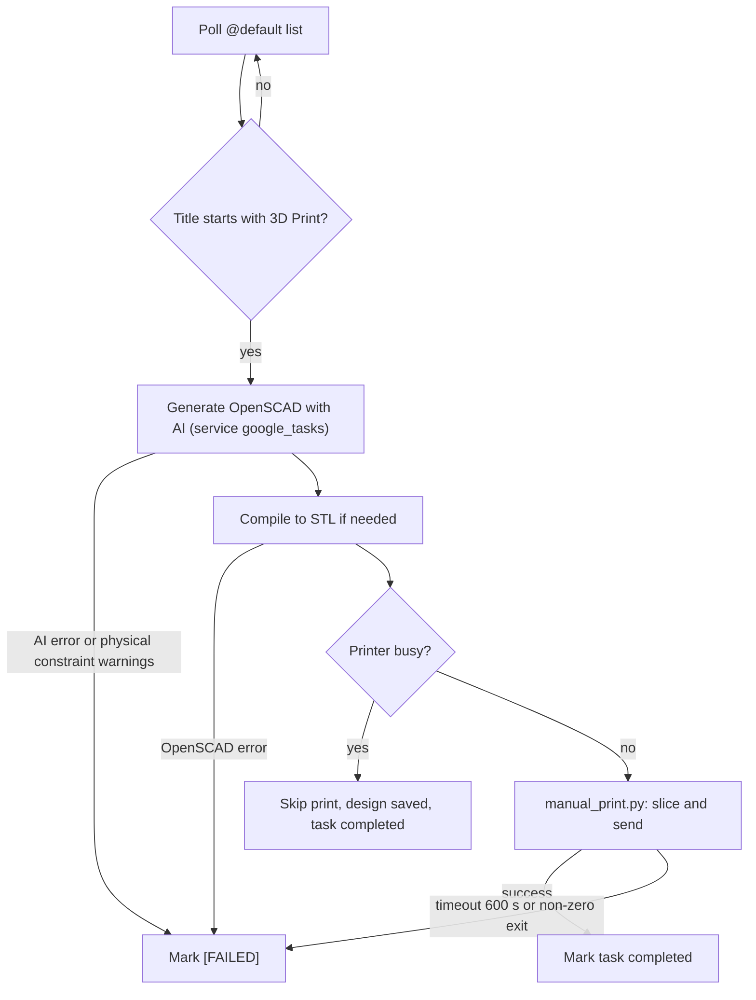

# Google Tasks Bot Guide

Add a task titled `3D Print: <idea>` to your default Google Tasks list and the bot designs, slices and prints it unattended.

Source: [bot.py](../../src/bots/google_tasks/bot.py).

## 1. Setup

### 1.1 Google Cloud Console

1. Open the [Google Cloud Console](https://console.cloud.google.com/) and create (or pick) a project.
2. **APIs & Services → Library** → enable **Google Tasks API**.
3. **APIs & Services → OAuth consent screen**: configure it (External is fine for personal use) and add your Google account as a **test user**.
4. **APIs & Services → Credentials → Create credentials → OAuth client ID**, application type **Desktop app**.
5. Copy the **Client ID** and **Client secret**.

### 1.2 Credentials in `.env` (supported route)

```env
GOOGLE_TASKS_CLIENT_ID=your-client-id
GOOGLE_TASKS_CLIENT_SECRET=your-client-secret
```

Template: [.env.example](../../.env.example). The bot builds an installed-app OAuth config from these two values (redirect `http://localhost`) and requests the scope `https://www.googleapis.com/auth/tasks`.

Credential lookup order in `authenticate_google_tasks()`:

1. Cached token `outputs/.cache/google_tasks_token.json` (reused and auto-refreshed).
2. `GOOGLE_TASKS_CLIENT_ID` + `GOOGLE_TASKS_CLIENT_SECRET` from `.env` / environment.
3. Legacy fallback: a downloaded client-secrets file at `inputs/google_tasks_api.json`.

Use the `.env` route; the JSON file is only a fallback when the `.env` pair is not both set.

### 1.3 First-run authorization

The first start opens a browser (local server on a random port) for Google consent. Run it interactively (`start.bat` option 3) the first time, approve access, and the token is written to `outputs/.cache/google_tasks_token.json`. Later runs are silent. Delete that file to force re-authorization (e.g. to switch accounts). A corrupt token or failed refresh triggers a new consent flow automatically.

## 2. Running

| Method | Command |
|---|---|
| Launcher menu | `start.bat`, then option **3** (Start Google Tasks Bot) |
| Direct | `uv run python -m src.bots.google_tasks.bot` |
| With everything | `start.bat` option **4** (supervisor) - authorize once via option 3 first so no browser prompt is needed |

Missing credentials: if there is no valid cached token, no `.env` pair and no `inputs/google_tasks_api.json`, the bot prints `ERROR: GOOGLE_TASKS_CLIENT_ID and GOOGLE_TASKS_CLIENT_SECRET not set in .env and credentials file not found at ...` plus `Please add GOOGLE_TASKS_CLIENT_ID and GOOGLE_TASKS_CLIENT_SECRET to .env.` and exits with code **1**.

## 3. How it works

`main()` authenticates, builds the Tasks v1 service, then loops forever: `process_tasks()` then sleep `POLL_INTERVAL` = **30 s**. Only the `@default` task list is read, and only incomplete tasks (`showCompleted=False`).

### Task format

- The title must start with `3D Print` (case-insensitive). A trailing `:` or `-` after it is stripped, e.g. `3D Print: a 40mm gear`.
- The **notes** field is appended on a new line to the prompt, so use it for dimensions or colors.
- Other tasks are ignored.

### Lifecycle



1. A session folder is created under the sessions directory (`generating_...`, then renamed from the model name), with `v1/` holding `.scad`, `.stl` and print scripts, and session JSON saved.
2. AI generation runs with `MAX_AI_CALLS` from `service_limits.google_tasks` (default **5**) and supports from the config below. Any physical-constraint warning fails the task.
3. The printer is checked over MQTT. If busy, the print is **skipped, the design stays in its session, and the task is still marked completed** (see warning below).
4. Otherwise [manual_print.py](../../src/cli/manual_print.py) is run with the STL, the requested colors (CSV) and `--support` if enabled (timeout 600 s). Success marks the task completed.
5. On any failure the task is patched: title becomes `[FAILED] <title>`, the error is appended to the notes as `[PRINT FAILED at <time>]: ...`, status stays `needsAction`.

> [!WARNING]
> `[FAILED]` tasks no longer start with `3D Print`, so they are **not retried**. To retry, create a new task (or rename it back to `3D Print: ...`). A task skipped because the printer was busy is marked completed without printing; re-submit or print it from the web UI session.

## 4. Configuration

Edit [agent_config.json](../../inputs/configs/agent_config.json):

| Key | Default | Meaning |
|---|---|---|
| `google_tasks_enable_supports` | `false` | Tree supports for Tasks jobs. Takes precedence. |
| `service_constraints.google_tasks.enable_supports` | not set | Used only if the top-level key is absent. |
| `service_limits.google_tasks` | `5` | Max AI calls per task. |
| `service_constraints.google_tasks.max_print_time_minutes` | `0` | 0 = unlimited. |
| `service_constraints.google_tasks.max_size_inches` | `0` | 0 = unlimited. |

The config is re-read for each task (supports), but `MAX_AI_CALLS` is read at process start, so restart the bot after changing `service_limits`. There is no per-task flag syntax; supports are global for this service.

## 5. Troubleshooting

| Symptom | Fix |
|---|---|
| Exit 1 with the credentials ERROR | Set both `.env` values (or place `inputs/google_tasks_api.json`). |
| `Access blocked` / 403 in browser | Add your account as a test user on the consent screen; confirm the Tasks API is enabled. |
| Browser consent never appears / hangs under supervisor | Run option 3 once in a normal console to cache the token. |
| Token expired every ~7 days | OAuth apps in "Testing" status expire refresh tokens; delete `outputs/.cache/google_tasks_token.json` and re-authorize or publish the app. |
| Task ignored | Title must begin with `3D Print` and the task must be in the default list and not completed. |
| `[FAILED]` title | Read the appended note (AI error, constraints, OpenSCAD error, print timeout or script exit code). |
| `An error occurred reading tasks: ...` | Transient API/network error; the loop continues on the next poll. |
| Nothing prints, task completed | Printer was reported busy; see the console log and console log and [08_bambu_and_safety_guide.md](08_bambu_and_safety_guide.md). |

## Related docs

- [01_system_architecture.md](01_system_architecture.md)
- [02_multi_ai_and_agent_loop.md](02_multi_ai_and_agent_loop.md)
- [03_web_interface_guide.md](03_web_interface_guide.md)
- [04_telegram_bot_guide.md](04_telegram_bot_guide.md)
- [06_slicing_and_3mf_pipeline.md](06_slicing_and_3mf_pipeline.md)
- [07_mesh_geometry_validation.md](07_mesh_geometry_validation.md)
- [08_bambu_and_safety_guide.md](08_bambu_and_safety_guide.md)
