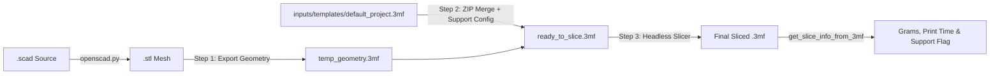

# 06: Slicing, 3MF Injection & AMS Color Matching Pipeline

This document describes how Text-to-Printer compiles OpenSCAD scripts into STL meshes, injects geometry into a pre-configured PLA project template (`default_project.3mf`), runs headless slicing via OrcaSlicer / Bambu Studio / PrusaSlicer, extracts physical print metrics from embedded G-code, and automatically matches filament colors against live AMS telemetry.

---

## 1. End-to-End Slicing Architecture

The slicing and geometry pipeline is implemented across three core modules:
- [`src/core/slicer/openscad.py`](../../src/core/slicer/openscad.py): OpenSCAD code sanitizing, headless `.scad` $\rightarrow$ `.stl` compilation, 2D preview rendering (`.png`), and binary/ASCII STL bounding-box calculation.
- [`src/core/slicer/slicer_3mf.py`](../../src/core/slicer/slicer_3mf.py): 3MF template geometry injection, support configuration, headless slicing, and G-code metadata extraction.
- [`src/core/printer/color_matcher.py`](../../src/core/printer/color_matcher.py): Hex color normalization, perceptual color naming, blandness scoring, and AMS slot selection.



---

## 2. OpenSCAD Compilation & STL Dimension Analysis

### Code Cleaning (`clean_scad_code`)
Before writing `.scad` code to disk, [`clean_scad_code()`](../../src/core/slicer/openscad.py) strips markdown code fences (` ```openscad ... ``` `) and unescapes literal `\n` sequences if the LLM returned a single-line escaped string.

### Headless Compilation (`compile_scad_to_stl`)
- Invokes the OpenSCAD binary resolved by [`get_openscad_path()`](../../src/core/config.py):
  ```text
  openscad -o <output.stl> <input.scad>
  ```
- **Default Timeout**: `60` seconds during validation loops (`600` seconds in direct `compile_and_slice`).
- **Validation**: Verifies both exit code `0` and a non-empty output `.stl` file (`os.path.getsize(out_stl_path) > 0`). If OpenSCAD exits cleanly but produces an empty mesh, compilation is marked as failed so the AI validation loop can self-correct.

### 2D Preview Rendering (`render_scad_preview_png`)
Generates a `1024x768` PNG preview using OpenSCAD's `--colorscheme=Tomorrow Night` flag for quick visual inspection.

### Bounding Box Calculation (`calculate_max_dimensions`)
Parses both **binary** and **ASCII** STL files directly in Python (using `struct` without heavy external CAD dependencies) to compute `(X, Y, Z)` dimensions in millimeters and inches (`format_dimensions_inches`). These physical dimensions are fed back into the AI verification prompt to check against `max_size_inches`.

---

## 3. Slicer executable Detection & Configuration

Executable paths are resolved in [`src/core/config.py`](../../src/core/config.py) using a layered priority order:

1. **Environment Variables**:
   - `OPENSCAD_PATH` for OpenSCAD.
   - `SLICER_PATH` for the slicer executable.
2. **Local System Config (`inputs/configs/system_config.json`)**:
   - Auto-created from [`inputs/configs/system_config.default.json`](../../inputs/configs/system_config.default.json) on first run (git-ignored so personal machine paths are never committed).
   - Searches configured candidate lists (`openscad_paths`, `bambu_studio_paths`, `slicer_paths`, `prusa_slicer_paths`).
3. **System `PATH` (`shutil.which`)**:
   - Checks `openscad`, `bambu-studio`, `orca-slicer`, `prusa-slicer-console`, and `prusa-slicer`.

---

## 4. Three-Stage 3MF Geometry Injection (`slice_stl_to_3mf`)

Bambu Lab printers expect a sliced `.3mf` project containing machine profiles, filament presets, and embedded G-code under `Metadata/`. Rather than slicing a bare STL with uncalibrated defaults, [`slice_stl_to_3mf()`](../../src/core/slicer/slicer_3mf.py) executes a 3-stage pipeline inside an isolated temporary directory (`outputs/tmp/slice_<random>/`):

### Stage 1: STL to Geometry 3MF
Converts the raw `.stl` mesh into a temporary geometry-only `.3mf` archive (`temp_geometry_<uuid>.3mf`):
- With OrcaSlicer / Bambu Studio: `<slicer> --export-3mf <temp_3mf> <stl_file>`
- With PrusaSlicer: `<slicer> --export-3mf --output <temp_3mf> <stl_file>`

### Stage 2: Injecting Geometry into `default_project.3mf`
Merges the new 3D mesh with the calibrated printer/filament settings in [`inputs/templates/default_project.3mf`](../../inputs/templates/default_project.3mf) to produce `ready_to_slice_<uuid>.3mf`:
- Copies all `3D/*` mesh entries, `[Content_Types].xml`, and `_rels/.rels` from the newly exported `temp_geometry.3mf`.
- Copies all `Metadata/*` entries from `inputs/templates/default_project.3mf`.
- **Tree Supports Injection**: When `enable_supports=True`, intercepts `Metadata/project_settings.config`, parses the JSON, and sets:
  ```json
  "enable_support": "1"
  ```
  (The template is pre-configured to use `tree(auto)` supports whenever `enable_support` is enabled.)

### Stage 3: Headless Slicing & Auto-Orient Fallback
Slices `ready_to_slice_<uuid>.3mf` into the final `.3mf` using Bambu Studio or OrcaSlicer:
```text
<slicer> --slice 0 --orient 1 --arrange 1 --export-3mf <out_3mf> <ready_3mf>
```
- **Automatic Fallback**: If `--orient 1` (auto-orientation) fails or times out (`300s`), `slice_stl_to_3mf()` automatically retries with `--orient 0` (`--slice 0 --orient 0 --arrange 1`) before reporting an error.
- **Cleanup**: The temporary `outputs/tmp/slice_*` directory is removed in a `finally` block.

### Smart 3MF Reuse (`_can_reuse_existing_3mf`)
Before re-slicing an existing version at print time, the pipeline checks if a sibling `.3mf` already exists, is newer than the `.stl` file, and has a `Metadata/project_settings.config` whose `enable_support` value matches the requested support setting. If it matches, the existing `.3mf` is reused immediately; otherwise, it re-slices on the fly.

---

## 5. G-Code Metadata Extraction (`get_slice_info_from_3mf`)

Once sliced, [`get_slice_info_from_3mf()`](../../src/core/slicer/slicer_3mf.py) inspects the `.gcode` file embedded inside the `.3mf` ZIP archive without extracting it to disk:
- **Estimated Print Time (`time`)**: Scans the header comments (first 100 lines) for `total estimated time` or `model printing time` and formats it via `format_time_str()` (e.g., `1h 15m 5s`).
- **Support Detection (`has_supports`)**: Scans G-code comments for `; type:support`, `; type:tree support`, `; feature: support`, `; feature: tree support`, or `; support_filament`.
- **Filament Weight (`grams`)**: Reads the last 1,000 lines in reverse to extract `; filament used [g] = <float>`.

---

## 6. AMS Color Matching (`src/core/printer/color_matcher.py`)

During AI generation, the LLM returns a `color_hierarchy` list ordered from most desirable to least desirable color (for example, `["Yellow", "Orange", "White"]`). When dispatching a print without an explicit manual slot override, [`match_color()`](../../src/core/printer/color_matcher.py) selects the optimal AMS slot (`0`–`3`):

1. **PLA & External Spool Filtering**:
   - Only considers **AMS slots `0`–`3`** loaded with `"PLA"` filament.
   - **Slot `4` (External Spool)** is excluded from automatic color matching and is only used when explicitly selected by the user.
2. **Filament Sufficiency Check**:
   - Groups trays by `(type, color_hex)` and checks whether available filament meets `required_grams` (`remain_pct * 10 >= required_grams`).
3. **Perceptual Color Mapping (`get_closest_color_name`)**:
   - Normalizes 3-, 6-, or 8-character hex codes from the AMS (`normalize_hex_color`) and computes Euclidean RGB distance to a 13-color palette (`Red`, `Green`, `Blue`, `Yellow`, `Orange`, `Purple`, `Black`, `White`, `Grey`, `Brown`, `Pink`, `Cyan`, `Magenta`).
4. **Scoring & Tie-Breaking**:
   - **Matched Color**: If an AMS tray matches a color in `requested_colors`, it receives a priority score of `-10000 + index * 100` (so earlier preferences in the AI's list always win).
   - **Fallback ("Blandness" Score)**: If none of the requested colors are loaded, `get_blandness_score()` computes `|R - G| + |G - B| + |B - R|`. Lower-saturation (more neutral/bland, like white, grey, or black) filaments win over neon colors.
   - **Spool Depletion Tie-Breaker**: If multiple slots hold the same winning color, the slot with the **lowest remaining percentage** is chosen first to help finish partial spools.

---

## 7. Important Safety Notice: PLA-Only Template

> [!WARNING]
> [`inputs/templates/default_project.3mf`](../../inputs/templates/default_project.3mf) is calibrated **strictly for PLA filament** (nozzle temperatures, bed temperatures, cooling fan curves, and volumetric flow). Do not use this pipeline to slice for PETG, ABS, ASA, or TPU unless you replace `default_project.3mf` with a template configured for that material.

---

## Related Docs
- [01 System Architecture](01_system_architecture.md)
- [02 Multi-AI & Agent Loop](02_multi_ai_and_agent_loop.md)
- [03 Web Interface Guide](03_web_interface_guide.md)
- [04 Telegram Bot Guide](04_telegram_bot_guide.md)
- [05 Google Tasks Bot Guide](05_google_tasks_bot_guide.md)
- [07 Mesh Geometry Validation](07_mesh_geometry_validation.md)
- [08 Bambu & Safety Guide](08_bambu_and_safety_guide.md)
