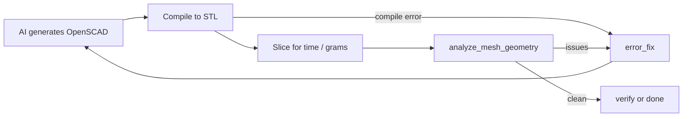

# Mesh Geometry Validation

After OpenSCAD compiles a design to STL, [`analyze_mesh_geometry`](../../src/core/slicer/mesh_validator.py) checks that the model is physically printable. Any problems are returned as plain-text errors and fed back to the AI so it can fix the design.

## Checks

`analyze_mesh_geometry(stl_path, expected_parts_count=1, min_thickness_mm=1.2, bed_threshold_mm=0.4) -> list[str]` returns an empty list when everything passes. It uses `trimesh` (and `scipy` for the thin-wall check).

| # | Check | Rule | Error text (summary) |
|---|-------|------|----------------------|
| 0 | Load | STL must load and have vertices | "Failed to load STL for analysis" / "STL mesh is empty" |
| 1 | Part count | Disconnected bodies (`mesh.split`) must equal `expected_parts_count` | "Expected N part(s) ... but found M disconnected part(s)" |
| 2 | Bed contact | For each body, `Z_min` must be `<= bed_threshold_mm` | "Part #i starts at Z=...mm in mid-air" plus bounding box and centroid |
| 3 | Thin walls / bottlenecks | Voxelize, fill, erode, count regions | "Part #i contains a weak structural bottleneck (< Xmm) near [X, Y, Z]" |

All messages start with `Geometry Error:` and are purely factual: they report what was found and where, but give no fix instructions.

### Thin-wall check details

1. Voxelize each body at pitch `max(0.4 mm, longest_extent / 250)` (0.4 mm matches the nozzle; large models use a coarser grid to bound runtime).
2. Fill the shell into a solid, then erode with a spherical element of radius `ceil((min_thickness_mm / 2) / pitch)` voxels (at least 1).
3. If the eroded solid splits into 2+ regions (ignoring regions under 4 voxels), a thin joint connects them. The error reports the point midway between the two largest regions.
4. If erosion removes the whole body, the check is skipped (the slicer step catches overly thin parts). Voxelization failures are skipped silently.

### Graceful degradation

- `trimesh` missing: prints a warning and skips all checks (returns `[]`).
- `scipy` missing: skips only the thin-wall check.
- If `mesh.split` fails, the mesh is treated as one body.

## Configuration

Settings live in [`inputs/configs/agent_config.json`](../../inputs/configs/agent_config.json), loaded by `_load_ai_config` in [`src/core/ai/validation_loop.py`](../../src/core/ai/validation_loop.py):

| Key | Default in code | Shipped value | Meaning |
|-----|-----------------|---------------|---------|
| `check_geometry_health` | `true` | `true` | Master switch for all checks above |
| `min_connection_thickness_mm` | `1.2` | `1.2` | Passed as `min_thickness_mm` |
| `bed_contact_threshold_mm` | `0.4` | `0.4` | Passed as `bed_threshold_mm` |

`expected_parts_count` is not in the config. The AI declares it in every response (JSON field, default `1`); the prompt in [`ai_instructions.txt`](../../inputs/ai_prompts/ai_instructions.txt) tells it to lay all parts of a multi-part assembly flat at Z=0.

Related limits in the same file: `max_print_time_minutes` and `max_size_inches` (0 = unlimited, overridable per service under `service_constraints`) are checked right next to geometry health.

## How failures feed the AI loop

1. `_evaluate_candidate_code` compiles the code, slices a temporary 3MF for size/time/filament, then calls the validator (only if `check_geometry_health` is true).
2. Geometry errors and constraint errors are merged into `all_issues`. If any exist the state becomes `error_fix`, otherwise `verify` (agent level 2+) or done.
3. In `error_fix` the geometry errors are joined with newlines and injected into the `{geometry_errors}` placeholder of [`error_prompt.md`](../../inputs/ai_prompts/error_prompt.md), together with the broken code and size. The AI returns corrected code.
4. The loop runs at most `max_ai_calls` AI calls (default 3; per-service overrides under `service_limits`). Candidates that compiled cleanly are remembered, and the loop falls back to the last working design if the AI service errors out.
5. `geometry_health` in the result reads `Passed (N part(s) detected, all grounded at Z=0, minimum joint thickness >= Xmm)` or `Warning - <errors>`.

See [Multi-AI and Agent Loop](02_multi_ai_and_agent_loop.md) for the full state machine and `agent_level` meanings.

## Tuning tips

- Models rejected for "mid-air" parts that are intentionally raised: increase `bed_contact_threshold_mm`, or set `check_geometry_health` to `false`.
- Delicate designs flagged as bottlenecks: lower `min_connection_thickness_mm` (below the 0.4 mm voxel pitch, erosion is 1 voxel minimum).
- Intentional multi-part prints: ask for it in the prompt so the AI sets `expected_parts_count` correctly.

## Related docs

- [01_system_architecture.md](01_system_architecture.md)
- [02_multi_ai_and_agent_loop.md](02_multi_ai_and_agent_loop.md)
- [03_web_interface_guide.md](03_web_interface_guide.md)
- [04_telegram_bot_guide.md](04_telegram_bot_guide.md)
- [05_google_tasks_bot_guide.md](05_google_tasks_bot_guide.md)
- [06_slicing_and_3mf_pipeline.md](06_slicing_and_3mf_pipeline.md)
- [08_bambu_and_safety_guide.md](08_bambu_and_safety_guide.md)
